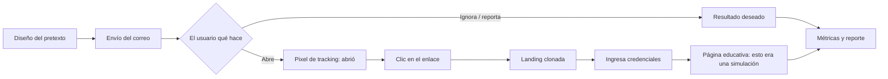

> ⚠️ **Metodología, no caso real.** Este artículo describe **cómo se hace** una simulación de
> concientización autorizada. No incluye datos, capturas ni resultados de ninguna campaña real:
> esos contienen PII de empleados y son confidenciales (Ley 1581 de 2012). Las cifras de ejemplo
> están marcadas como ilustrativas.

## Por qué esto importa más que un exploit

Puedes parchear un servidor. No puedes parchear a una persona con un `apt upgrade`. Por eso el
**phishing sigue siendo uno de los vectores de acceso inicial más frecuentes** año tras año en los
informes de la industria (p. ej. el *Verizon DBIR*): es barato, escala y ataca la capa que no tiene
firma ni CVE — el criterio humano.

En el sector financiero colombiano no es opcional: la **Circular Externa 007 de 2018 de la
Superfinanciera** exige, dentro de la gestión de riesgo de ciberseguridad, programas de
**concientización** del personal. Una simulación de phishing es la forma de **medir** si esa
concientización funciona, en vez de asumirlo.

El punto clave: el objetivo de una simulación **no es técnico**. Es conductual y medible. No se
trata de "hackear" al empleado, sino de bajar una curva de riesgo campaña tras campaña.

## Concientización no es una trampa

Antes de tocar una herramienta, el encuadre ético y legal, porque aquí se separa el profesional del
imprudente:

- **Autorización por escrito de la dirección.** Igual que cualquier pentest, esto se hace con un
  alcance firmado. Sin eso, no se lanza.
- **No es punitivo.** Quien cae no se expone ni se sanciona. El fin es educar, no humillar; si la
  gente teme el castigo, oculta los incidentes reales — justo lo contrario de lo que quieres.
- **Datos de empleados = datos personales.** Las métricas se tratan bajo la Ley 1581: finalidad
  definida, acceso restringido, y mejor **agregadas** (tasas por área) que individualizadas.
- **El pretexto no causa daño.** Nada de "fuiste despedido" o "tu bono fue cancelado". Realista,
  sí; cruel, no.

## Cómo funciona una simulación

El flujo completo, de principio a fin:



Fíjate que el final del camino "malo" **no es capturar la clave**: es **redirigir a una página que
enseña** qué señales debió notar. Ahí está el valor pedagógico.

## El montaje con Gophish

[Gophish](https://getgophish.com) es un framework open-source para simulaciones de phishing. Cinco
piezas: **Sending Profile** (el SMTP que envía), **Groups** (destinatarios), **Email Template** (el
correo), **Landing Page** (la página falsa) y **Campaign** (todo junto).

### 1. Levantar el servidor

```bash
# descargar el release desde github.com/gophish/gophish y descomprimir
unzip gophish-v0.12.1-linux-64bit.zip -d gophish && cd gophish

# config.json: separar el panel admin del servidor de phishing
#   admin_server -> 127.0.0.1:3333  (solo local)
#   phish_server -> 0.0.0.0:80      (el que ve la víctima)
sudo ./gophish
```

La primera vez, Gophish **imprime en consola una contraseña temporal de admin** (versiones ≥0.10).
Panel en `https://127.0.0.1:3333`.

### 2. Sending Profile, plantilla y landing

- **Sending Profile:** el SMTP autorizado desde donde sale el correo. Para que el ejercicio sea
  realista conviene un **dominio *look-alike*** propio y registrado por ti (p. ej. `s0lfinanzas` con
  cero), nunca suplantar un dominio ajeno sin control.
- **Email Template:** admite variables — `{{.FirstName}}`, `{{.URL}}` (el enlace rastreado) y
  `{{.Tracker}}` (el pixel invisible que marca "abrió"). Un buen pretexto trae **pistas aprendibles**:
  un dominio raro, una urgencia artificial, un saludo genérico.
- **Landing Page:** se puede *importar* un sitio real y activar **Capture Submitted Data**. Lo
  importante: en **Redirect to** apuntar a tu **página educativa**, para que al enviar el formulario
  la persona aprenda en el acto.

> **Sobre capturar contraseñas:** Gophish puede hacerlo, pero para concientización rara vez hace
> falta — con saber que *hubo* envío basta, y guardar claves reales de empleados es un pasivo que no
> quieres. Si se captura, se *hashea* o se descarta de inmediato; nunca se almacena en claro.

### 3. Grupos y campaña

Importas los destinatarios (CSV), combinas las piezas en una **Campaign**, programas el envío y
Gophish registra en tiempo real: enviado → abierto → clic → datos enviados → **reportado**.

## Qué se mide (y qué métrica importa de verdad)

| Métrica | Qué dice | Ejemplo ilustrativo |
|---|---|---|
| Tasa de apertura | Cuántos abrieron el correo | ~40 % |
| Tasa de clic | Cuántos siguieron el enlace | ~15 % |
| Envío de credenciales | Cuántos entregaron datos | ~6 % |
| **Tasa de reporte** | **Cuántos lo denunciaron al SOC** | **~20 %** |

*(Números de ejemplo, no de ninguna campaña real.)*

La métrica estrella no es cuántos cayeron: es la **tasa de reporte**. Un empleado que reporta es un
sensor humano. El éxito del programa se ve cuando, campaña tras campaña, **el clic baja y el reporte
sube**.

## La cara azul — lo que vuelve esto *purple*

Un writeup de phishing que solo cuenta el ataque está a medias. Lo que de verdad protege es el otro
lado:

**Detección**

- **SPF, DKIM y DMARC** mal configurados son lo que permite la suplantación. Con **DMARC en
  `p=reject`**, el correo que falla la autenticación ni llega.
- **Cabeceras del correo:** `Received-SPF`, `Authentication-Results`, un `Return-Path` que no cuadra
  con el `From`.
- **Dominio *look-alike*:** monitoreo de registros parecidos a tu marca (typosquatting).
- **Un botón "Reportar phishing"** en el cliente de correo (O365 / Gmail) que alimenta al SOC —
  convierte a cada usuario en telemetría.

**Mitigación en capas**

- **MFA.** Aunque capturen la credencial, un segundo factor frena el acceso. Es el control de mayor
  retorno.
- **DMARC en `reject`** + filtrado en el gateway.
- **El programa recurrente** de concientización: una campaña aislada no mueve la aguja; la cadencia sí.

**Mapeo a marcos**

| Marco | Referencia |
|---|---|
| MITRE ATT&CK | **T1566 – Phishing** |
| ISO/IEC 27001:2022 | **A.6.3** Concientización, educación y formación |
| NIST CSF 2.0 | Función **PR** (Protect) – *Awareness & Training* |
| Colombia (financiero) | **Circular Externa 007/2018** – gestión de riesgo cibernético (SARO) |

## Cierre

La simulación de phishing bien hecha no mide cuánta gente es "tonta". Mide qué tan resiliente es la
organización y, sobre todo, **qué tan rápido reacciona**. El entregable no es la lista de quién cayó:
es la curva que baja, el botón de reporte que se usa, y el MFA que convierte una credencial robada en
un callejón sin salida.

Atacar enseña a defender. Esa es la idea de todo este sitio.
